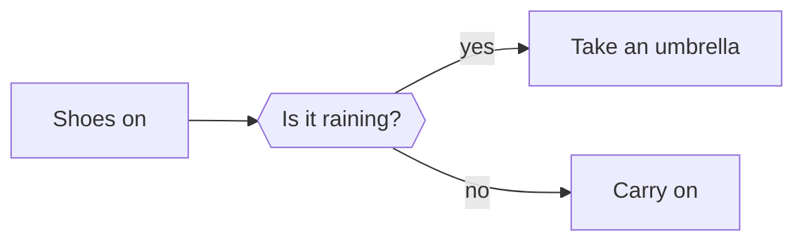

# Diagrams with Mermaid

A picture is worth a thousand words, so the saying goes.
Perhaps not every picture is quite worth that, but for technical documentation a diagram can go a long way.

Your Redocly project supports [Mermaid diagrams](https://mermaid.js.org/), which are written in text as part of the Markdown page, and then rendered as diagrams when the page is displayed.

Here's an example of how a diagram is described in Mermaid:

````text

````

The output shows up like the following image:


Describing the diagrams as part of the content of the page makes it easier to maintain because the text can easily be updated, and all the diagrams are displayed with a consistent style.
